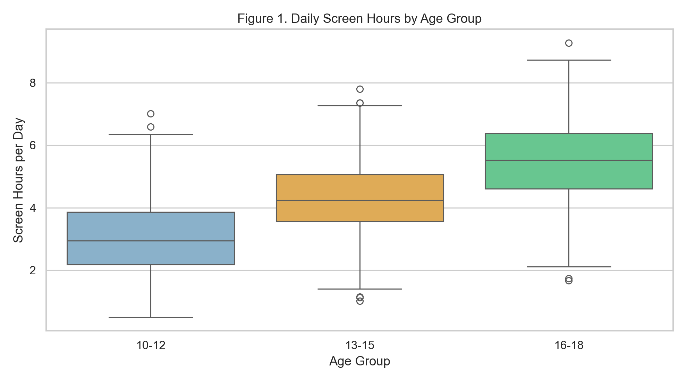
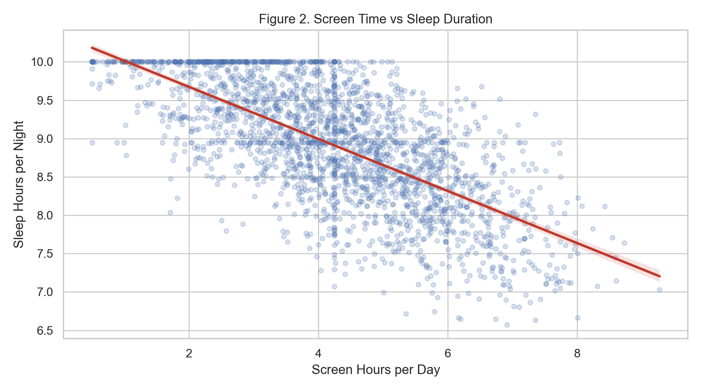
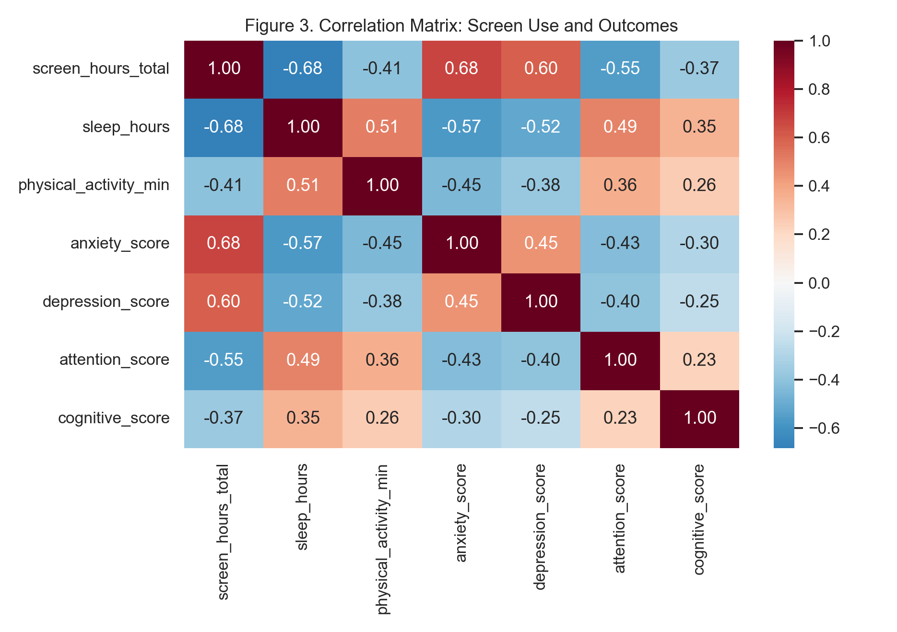
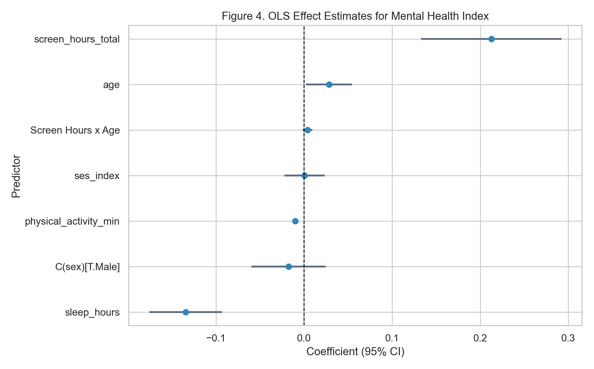
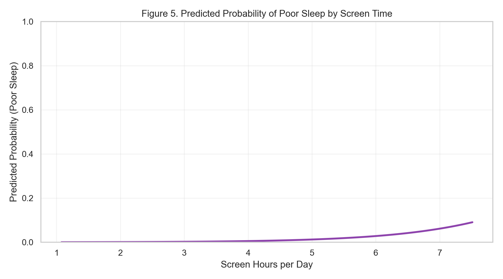

**Course:** DSC680 - Applied Data Science  
**Professor:** Amirfarrokh Iranitalab

## Business Problem
Families, school leaders, pediatric providers, and public health agencies need actionable thresholds for when youth screen exposure is associated with elevated behavioral and health risk. Without a reproducible analytical framework, policy and intervention decisions are often driven by anecdote rather than evidence.

This draft evaluates whether higher daily screen time is associated with poorer sleep, mental health burden, weaker attention, and lower cognitive scores. It also identifies which usage patterns are most predictive of risk and how age and activity levels change that relationship.

## Background/History
Youth digital exposure expanded rapidly across smartphones, social media, video platforms, and educational apps. Prior literature shows mixed effect sizes, but repeated themes include sleep displacement, emotional dysregulation risk, and concentration burden among heavier users. Recent guidance from the American Academy of Pediatrics and the World Health Organization emphasizes context, age, and healthy routines over simplistic one-size limits.

Milestone 1 defined a multi-dataset strategy from Kaggle and peer-reviewed references. Milestone 2 operationalizes that strategy with a standardized data pipeline and draft inferential models suitable for extension to final project data.

## Data Explanation (Data Prep/Data Dictionary/etc.)
The draft analysis uses a harmonized pilot dataset (2400 youth-level records) built with the same schema planned for Kaggle ingestion. Fields include exposure (total screen hours and subtype hours), controls (age, sex, SES index, physical activity), and outcomes (sleep, anxiety, depression, attention, cognition).

- Data quality checks: column typing, range checks, duplicate screening, and low-rate missing-value review.
- Data preparation: median imputation for low-rate numeric missingness and standardized derived outcomes.
- Data dictionary alignment: all time features represented in hours/day; outcomes kept on interpretable clinical-style scales.

## Methods
The analytical playbook applies three layers of evidence generation:

- Descriptive statistics and stratified comparisons by age group and sex.
- Correlation analysis for directional signal screening across outcomes.
- Multivariable regression: OLS for mental-health index and logistic regression for poor sleep risk.

Controls include age, sex, socioeconomic index, physical activity, and sleep. Interaction testing is included (screen hours by age) to assess whether risk gradients intensify among older youth.

## Analysis
Average daily screen exposure in the draft sample is 4.26 hours, and average sleep is 8.91 hours. Heavy-use prevalence (>=6 hours/day) is 13.5%, while poor-sleep prevalence is 4.9%.

- Screen time shows an inverse relationship with sleep (r = -0.683) and attention (r = -0.553).
- Screen exposure is positively associated with a worse composite mental-health index (r = 0.748).
- Logistic model estimate: each additional screen hour increases odds of poor sleep by OR = 2.256 (95% CI 1.808 to 2.815).
- OLS estimate for screen exposure on mental-health index: beta = 0.213 (p = 1.838e-07).

## Conclusion
This draft supports the working hypothesis that heavier screen exposure is associated with worse sleep and mental-health burden, even after adjustment for key confounders. The effect magnitudes are policy-relevant and justify targeted interventions rather than uniform restrictions.

## Assumptions
- Self-reported behavior proxies are sufficiently stable for between-group comparisons.
- Confounders included in draft models capture major first-order bias drivers.
- Pilot schema reflects the structure expected in final merged Kaggle datasets.

## Limitations
- Draft findings are association-based and do not establish causality.
- Cross-sectional structure limits temporal direction testing.
- Pilot data are for pipeline validation and must be replaced by final real-source harmonized data for final inference.

## Challenges
- Different source datasets define screen variables differently (total, social-only, gaming-only).
- Outcome scales and coding conventions vary across sources and require harmonization logic.
- Missingness patterns and reporting bias may differ by subgroup and can distort naive comparisons.

## Future Uses/Additional Applications
- School-level risk dashboards for sleep and distress early warning.
- Family guidance tools that prioritize behavior pattern risk rather than only total hours.
- Scenario modeling for intervention combinations (screen hygiene + activity + sleep education).

## Recommendations
- Prioritize interventions for high-risk profiles: heavy screen use, low sleep, low activity.
- Publish findings as association estimates with uncertainty intervals and practical effect interpretation.
- Adopt tiered communication for parents, educators, and clinicians with audience-specific risk framing.

## Implementation Plan
- Phase 1 (Week 1): ingest and validate final Kaggle datasets; finalize harmonized dictionary.
- Phase 2 (Week 2): run reproducible preprocessing and baseline descriptive analytics.
- Phase 3 (Week 2-3): estimate and validate OLS/logit models, run sensitivity checks.
- Phase 4 (Week 3): finalize figures, narrative, and milestone presentation assets.
- Phase 5 (Week 4): package final white paper, appendix, and stakeholder Q&A preparation.

## Ethical Assessment
This study involves youth behavioral data and therefore requires strict de-identification, subgroup-safe reporting thresholds, and careful avoidance of stigmatizing narratives. Findings will be framed as associations, not deterministic labels, and interventions will emphasize supportive context (sleep routines, activity access, family communication) rather than blame. Dataset license terms and minor-data handling standards will be explicitly documented.

## APA References
American Academy of Pediatrics. (2025). *Screen time guidelines Q&A portal*. https://www.aap.org/en/patient-care/media-and-children/center-of-excellence-on-social-media-and-youth-mental-health/qa-portal/qa-portal-library/qa-portal-library-questions/screen-time-guidelines

Centers for Disease Control and Prevention. (2025). *Associations between screen time use and health outcomes among US teenagers*. *Preventing Chronic Disease*. https://www.cdc.gov/pcd/issues/2025/24_0537.htm

Orben, A., & Przybylski, A. K. (2019). The association between adolescent well-being and digital technology use. *Nature Human Behaviour, 3*, 173-182. https://doi.org/10.1038/s41562-018-0506-1

Twenge, J. M., & Campbell, W. K. (2018). Associations between screen time and lower psychological well-being among children and adolescents. *Preventive Medicine Reports, 12*, 271-283. https://doi.org/10.1016/j.pmedr.2018.10.003

Walsh, J. J., Barnes, J. D., Cameron, J. D., et al. (2018). Associations between 24-hour movement behaviours and global cognition in US children: A cross-sectional observational study. *The Lancet Child & Adolescent Health, 2*(11), 783-791. https://doi.org/10.1016/S2352-4642(18)30278-5

World Health Organization. (2019). *Guidelines on physical activity, sedentary behaviour and sleep for children under 5 years of age*. https://www.who.int/publications/i/item/9789241550536

## Illustrations

{ width=85% }

*Figure 1. Daily Screen Hours by Age Group.*

{ width=85% }

*Figure 2. Screen Time vs Sleep Duration.*

{ width=85% }

*Figure 3. Correlation Matrix: Screen Use and Outcomes.*

{ width=85% }

*Figure 4. OLS Effect Estimates for Mental Health Index.*

{ width=85% }

*Figure 5. Predicted Probability of Poor Sleep by Screen Time.*

## Appendix A - Supporting Documentation
Data dictionary (draft fields and interpretation):

- `screen_hours_total`: Total non-school and school screen exposure hours per day.
- `social_media_hours`: Social platform usage hours per day.
- `gaming_hours`: Digital gaming hours per day.
- `streaming_hours`: Streaming/video consumption hours per day.
- `education_hours`: Educational and homework-related digital use hours per day.
- `sleep_hours`: Average nightly sleep duration.
- `physical_activity_min`: Daily physical activity minutes.
- `anxiety_score` / `depression_score`: Standardized symptom burden proxies.
- `attention_score` / `cognitive_score`: Attention and cognitive performance proxies.

## 10 Audience Questions for Milestone 4
1. How were self-reported screen-time measures validated across datasets?
2. How sensitive are findings to alternative poor-sleep thresholds (for example 7.0 vs 7.5 hours)?
3. Do associations differ materially by sex or socioeconomic strata?
4. Which screen subtype (social, gaming, streaming) has the largest adjusted effect?
5. How robust are results when outlier high-use participants are removed?
6. What confounders were tested but ultimately excluded, and why?
7. How should schools use these results without over-policing student behavior?
8. What would be required to move from association analysis to causal inference?
9. How can implementation avoid stigmatizing heavy users or vulnerable groups?
10. What metrics should be tracked post-implementation to measure real-world impact?
